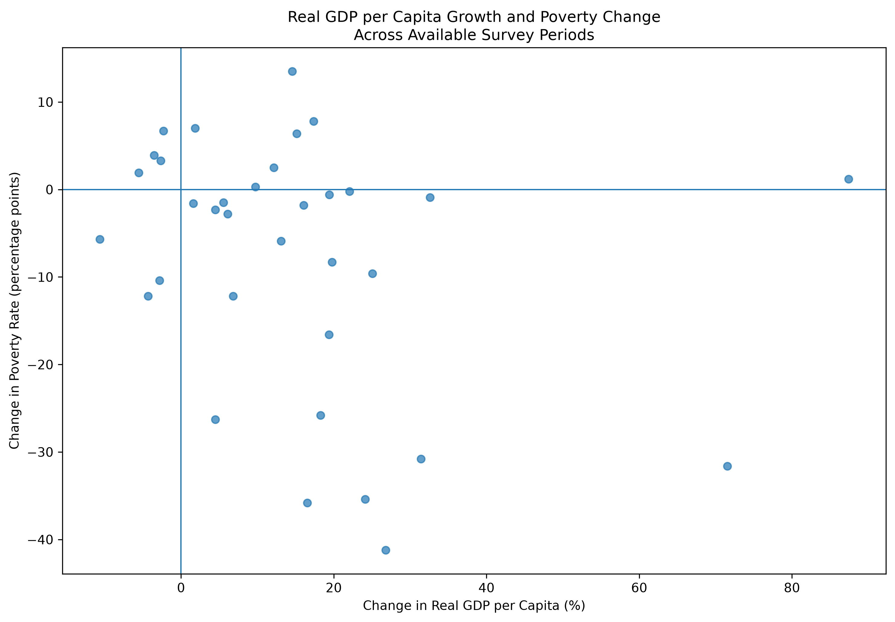

# Economic Growth and Poverty Reduction in Sub-Saharan Africa

### Evidence from 48 countries, 2010–2024

This project examines whether economic growth translates into lower poverty across Sub-Saharan Africa—and why countries experiencing economic expansion can still have very different poverty outcomes.

Using World Bank data for **48 countries from 2010 to 2024**, the project combines Python-based economic analysis, fixed-effects econometrics, an interactive Power BI dashboard, and a policy brief.

> **Key takeaway:** Economic growth is important for poverty reduction, but growth alone does not guarantee lower poverty. Income distribution emerges as the most consistent correlate of within-country poverty dynamics.

---

## Dashboard Preview


The Power BI dashboard provides an interactive view of growth and poverty outcomes across Sub-Saharan Africa, individual country trajectories, socioeconomic differences, and the main econometric findings.

[**View the Power BI project files →**](Dashboard/)

---

## Headline Findings

### Growth usually coincides with poverty reduction—but not always

Among the **27 countries** that experienced increases in real GDP per capita over their observed poverty intervals:

- **20 experienced poverty reduction**
- **7 experienced rising poverty**

Economic expansion was therefore more commonly associated with improving poverty outcomes, but growth did not translate uniformly into lower poverty.

### Inequality provides the most consistent result

The Gini index remains **positively and statistically significantly associated with poverty** across the fixed-effects specifications in which it is included.

The relationship remains robust after adding socioeconomic controls, restricting the analysis to the smaller education-data sample, and introducing alternative time controls.

### Employment quantity alone can be misleading

Employment shows different relationships depending on whether countries are compared with one another or changes within countries are examined over time.

The findings suggest that employment participation should be considered alongside **productivity, earnings, informality and job quality** when evaluating household welfare.

### Infrastructure access is not the same as welfare impact

Electricity access strongly distinguishes lower-poverty from higher-poverty countries in the pooled data, but it does not independently explain within-country poverty variation in the fixed-effects models.

This suggests that infrastructure monitoring should extend beyond connections to consider **reliability, affordability and productive use**.

### Human capital provides supporting evidence

Higher lower-secondary completion is associated with lower poverty in the education-augmented model. However, limited education data substantially reduce the estimation sample, so this finding is treated as supporting rather than primary evidence.

---

## Growth and Poverty Across Countries



The country-level analysis illustrates substantial variation in how changes in real GDP per capita correspond with changes in poverty.

This variation motivates the central question of the project: **what determines whether economic expansion translates into improved household welfare?**

---

## Research Questions

The analysis addresses five questions:

1. How has real economic performance evolved across Sub-Saharan African countries?
2. Has economic growth generally been accompanied by reductions in poverty?
3. Why have some growing economies experienced stronger poverty reduction than others?
4. How are inequality, employment, infrastructure, inflation and human capital associated with poverty?
5. Do relationships observed across countries persist when changes **within countries over time** are examined?

---

## Data

The project uses data retrieved primarily through the **World Bank API**, creating a reproducible country-year dataset covering **2010–2024**.

| Dimension | Indicator |
|---|---|
| Economic performance | Real GDP per capita (constant 2015 US$) |
| Poverty | Poverty headcount rate |
| Inequality | Gini index |
| Labour market | Employment-to-population ratio |
| Infrastructure | Access to electricity |
| Macroeconomic conditions | Inflation rate |
| Human capital | Lower-secondary completion rate |

The master dataset covers **48 Sub-Saharan African countries and 720 potential country-year observations**.

Poverty estimates are less frequent because comparable observations depend on household surveys. The econometric analysis therefore uses an **unbalanced survey-based panel** and does not interpolate poverty values between survey years.

---

## Methodology

The analysis progresses from descriptive evidence to multivariate econometric analysis.

### 1. Descriptive analysis

Country-level patterns are examined across economic performance, poverty, employment, infrastructure, inflation, inequality and education.

### 2. Growth–poverty classification

Countries with sufficient poverty observations are classified into four outcomes:

- **Growth + Poverty Reduction**
- **Growth + Poverty Increase**
- **Contraction + Poverty Increase**
- **Contraction + Poverty Reduction**

### 3. Bivariate analysis

Pearson and Spearman correlations examine the relationship between observed poverty and selected socioeconomic indicators.

### 4. Fixed-effects econometric analysis

Country fixed-effects models examine whether changes in socioeconomic conditions **within countries** are associated with changes in poverty.

The models progressively introduce:

- real GDP per capita;
- inequality;
- employment;
- electricity access;
- inflation; and
- lower-secondary completion.

Standard errors are clustered at the country level.

### 5. Robustness checks

The analysis evaluates whether the main relationships remain under alternative samples and time controls, including full year fixed effects and the smaller education-data sample.

---

# Interactive Power BI Dashboard

The Power BI report translates the analysis into a three-page interactive analytical product.

## Page 1 — Poverty & Growth Overview

The overview provides headline development indicators and compares countries across growth–poverty outcomes.

The dashboard preview at the top of this README shows the complete page.

## Page 2 — Country Poverty Dynamics


Users can select individual countries and compare observed poverty trajectories with annual changes in real GDP per capita.

This makes it possible to distinguish the annual macroeconomic trajectory from the less frequent household-survey observations used to measure poverty.

## Page 3 — Factors Associated with Poverty Change


The final page combines descriptive socioeconomic comparisons with the principal fixed-effects results.

It highlights the distinction between indicators that characterize broader structural development and those associated with poverty changes within countries.

---

# Policy Brief

The research findings are also translated into a standalone policy brief:

### **When Growth Is Not Enough: Making Economic Expansion More Poverty-Reducing in Sub-Saharan Africa**

The brief translates the empirical findings into five policy priorities:

1. Evaluate both the **sources and distribution** of economic growth.
2. Focus employment strategies on **productive and higher-quality work**.
3. Measure infrastructure through **quality and productive use**, not access alone.
4. Connect human-capital development to **productive economic opportunities**.
5. Monitor **poverty, inequality and labour-market outcomes alongside GDP growth**.

[**Read the Policy Brief (PDF) →**](Policy_brief/Sub_Saharan_Africa_Growth_Poverty_Policy_Brief.pdf)

An editable Word version is also available in the [`Policy_brief`](Policy_brief/) folder.

---

# Policy Relevance

The findings support an **inclusive-growth approach** to poverty reduction.

Aggregate growth remains important, but GDP per capita alone provides an incomplete measure of whether development is improving household welfare.

For development monitoring and policy evaluation, economic performance should therefore be considered alongside:

- poverty;
- inequality;
- employment quality;
- household access to productive opportunities;
- human capital; and
- the quality and usability of infrastructure.

A broader implication is methodological:

> **The factors that distinguish richer from poorer countries are not necessarily the same factors that explain changes in poverty within countries over time.**

---

# Analytical Outputs

Selected results are provided separately so users can examine the final evidence without rerunning the entire notebook.

### Figures

[`Output/Figures/`](Output/Figures/)

- `growth_poverty_relationship.png`
- `real_gdp_per_capita_change.png`

### Tables

[`Output/Tables/`](Output/Tables/)

- `growth_poverty_classification.csv`
- `correlation_results.csv`
- `fixed_effects_results.csv`

---

# Repository Structure

```text
africa-growth-poverty-analysis/
│
├── README.md
├── requirements.txt
│
├── Dashboard/
│   ├── Africa_Poverty_Growth_Analysis.pbix
│   ├── Poverty & Growth Overview.png
│   ├── Country Poverty Dynamics.png
│   └── Factors Associated with Poverty Change.png
│
├── Data/
│   ├── ssa_development_master_2010_2024.csv
│   ├── powerbi_country_year.csv
│   ├── powerbi_growth_poverty.csv
│   ├── powerbi_factors.csv
│   └── powerbi_regression_results.csv
│
├── Notebook/
│   └── Africa_Poverty_Analysis.ipynb
│
├── Output/
│   ├── Figures/
│   │   ├── growth_poverty_relationship.png
│   │   └── real_gdp_per_capita_change.png
│   │
│   └── Tables/
│       ├── growth_poverty_classification.csv
│       ├── correlation_results.csv
│       └── fixed_effects_results.csv
│
└── Policy_brief/
    ├── Sub_Saharan_Africa_Growth_Poverty_Policy_Brief.pdf
    └── Sub_Saharan_Africa_Growth_Poverty_Policy_Brief.docx
```

---

# Tools and Technologies

### Python

- pandas
- NumPy
- requests
- Matplotlib
- SciPy
- Statsmodels

### Visualization

- Power BI

### Data

- World Bank API
- World Development Indicators
- World Bank poverty data

### Analytical Methods

- Descriptive statistics
- Country-level growth–poverty classification
- Pearson correlation
- Spearman rank correlation
- Country fixed-effects regression
- Country-clustered standard errors
- Alternative time controls
- Sample robustness analysis

---

# Reproducing the Analysis

Install the required Python packages:

```bash
pip install -r requirements.txt
```

Then open:

```text
Notebook/Africa_Poverty_Analysis.ipynb
```

The notebook retrieves the underlying World Bank indicators through API requests, constructs the analytical dataset, performs the descriptive and econometric analysis, and generates the supporting datasets used in the Power BI report.

---

# Limitations

The findings should be interpreted with several limitations in mind.

**Sparse poverty observations.** Comparable poverty estimates depend on household surveys and are therefore irregular across countries and years. The fixed-effects analysis relies on an unbalanced survey-based panel.

**Associational rather than causal evidence.** Country fixed effects account for persistent country characteristics but do not eliminate time-varying omitted variables, reverse causality or simultaneous relationships.

**Indicator limitations.** Employment participation does not capture job quality or informality; electricity access does not capture reliability or affordability; and headline inflation may not reflect the price pressures experienced by poorer households.

**Human-capital data constraints.** Lower-secondary completion has substantially lower coverage, reducing the estimation sample in the education-augmented specification.

The econometric estimates should therefore be interpreted as **conditional within-country associations rather than causal policy effects**.

---

# Project Deliverables

This repository brings together four complementary products:

| Deliverable | Purpose |
|---|---|
| **Python research notebook** | Reproducible economic and econometric analysis |
| **Power BI dashboard** | Interactive exploration and communication |
| **Policy brief** | Decision-oriented interpretation of the findings |
| **Analytical outputs** | Reusable figures, tables and datasets |

Together, they demonstrate an end-to-end analytical workflow from **data acquisition and economic research to econometric analysis, visualization and policy communication**.